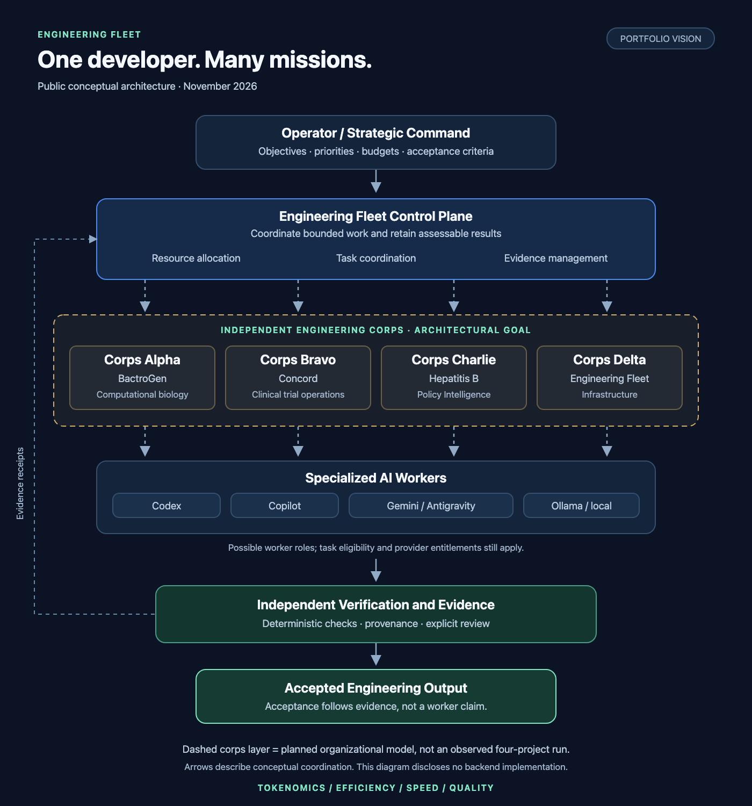
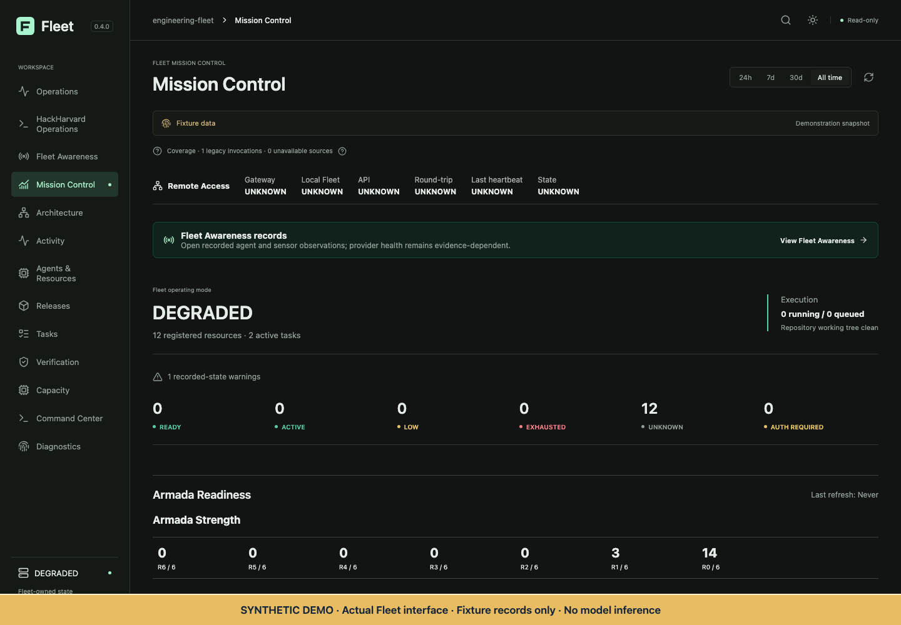

# Engineering Fleet

### One Developer. Multiple Engineering Corps. Four Objectives.

**Tokenomics | Efficiency | Speed | Quality**

I couldn't afford an engineering team, so I started building the infrastructure to coordinate one out of AI agents.

I'm a Brown University PLME student working across biotechnology research, medical AI startups, hackathons, and independent software engineering. The constraint is simple: I have more projects I want to build than I can execute sequentially.

Inspired by Napoleon's corps system, Engineering Fleet is designed to coordinate specialized AI coding workers as semi-independent engineering units under shared strategic command.

**Why work on one project when I could advance all of them?**

Fleet's objective is to **maximize verified engineering output per dollar, per token, per unit of time, and per unit of human attention.**

> **Status · November 1, 2026:** Proprietary engineering prototype with a tested control plane and historical bounded live coding demonstrations. The latest completed full verification recorded **2,527 passed, six skipped, zero failed**. Simultaneous multi-project corps remain an architectural goal; the repaired runtime has no positive live acceptance, and dispatch remains suspended at the reviewed checkpoint. [Evidence and scope](docs/engineering-results.md).

## Four foundational objectives

| Objective | What Fleet is designed to optimize | What counts as progress |
|---|---|---|
| **I. Tokenomics** | Match task requirements to model capability and cost; reuse retained evidence; account for failures and retries. | Lower total cost per independently verified result. A cheap failure is still a cost. |
| **II. Efficiency** | Preserve context, coordinate bounded work, and make handoffs repeatable. | Less coordination and duplicated effort per accepted outcome. Human-attention savings are not yet quantified. |
| **III. Speed** | Advance eligible independent work concurrently, with explicit dependencies and resource limits. | Measured throughput and completion latency, including coordination and verification overhead. No general speedup is established. |
| **IV. Quality** | Require deterministic checks, provenance, independent acceptance, and explicit review. | Correct, reproducible results bound to a specific source version. A worker's completion claim is not proof. |

These objectives compete. Stronger models can avoid costly retries; more workers can introduce contention. Fleet aims to optimize the complete engineering outcome. [Optimization philosophy](docs/four-objectives.md).

## The corps architecture

Napoleon's corps could operate independently while remaining coordinated under a shared strategic command. Fleet borrows that organizational idea: give each engineering unit an objective, resources, execution scope, and acceptance criteria.

The operator sets strategy. Fleet coordinates tasks and evidence. Specialized workers produce candidates. Independent verification determines what can be accepted.

**One developer. Multiple engineering corps. Many simultaneous missions.**

Conceptual assignments include Alpha for BactroGen, Bravo for Concord, Charlie for Hepatitis B Policy Intelligence, and Delta for Fleet infrastructure. These illustrate the intended portfolio architecture; they are not evidence of four corps operating simultaneously. [Architecture](docs/architecture.md).

## System architecture

*Public conceptual diagram. Corps assignments and simultaneous execution are architectural goals. Worker names represent possible roles, not current eligibility or provider entitlements.*

## Current verified engineering capabilities

| Capability | Evidence classification | Practical meaning |
|---|---|---|
| Provider-neutral task lifecycle and bounded worker assignments | **Implemented; Engineering Verified** | Objectives, scope, worker output, verification, and review are separate records. |
| Economic routing and invocation limits | **Implemented; Engineering Verified** | Eligible configured executors can be selected under declared task constraints. Cost savings are unproven. |
| Evidence retention and artifact provenance | **Implemented; Engineering Verified** | Retained outputs can be checked and associated with source and verification records. |
| Mission Control and resource views | **Implemented; Engineering Verified** | Recorded tasks, provider state, proof, and unknowns are inspectable. Demo values are synthetic. |
| Bounded coding through draft delivery | **Operationally Verified — historical scope only** | Five paired historical Fleet cases reached verified draft delivery at an older source version. |
| Simultaneous corps across the project portfolio | **Planned** | Requires fresh operational evidence across repositories and eligible providers. |

“Engineering Verified” describes defined test scopes, which include fixtures; it does not commission every adapter. [Definitions and evidence](docs/engineering-results.md).

## Mission Control demonstration

**Synthetic demonstration of the actual interface.** Task states, providers, counts, and capacity readings are fixture values. This capture uses a frozen build, an empty demonstration repository, and an isolated home. No model inference was initiated. It is not a live fleet or a production performance claim.

[Demonstration walkthrough](docs/mission-control-demo.md) · [Animated walkthrough](assets/demo.gif) · [Illustrative execution record](examples/synthetic-execution.json)

## Hackathon impact and personal development

My hackathon experience made the value of coordinated engineering tangible:

- **BactroGen · Hack-Nation MIT:** Second Place in the Databricks Track; a nine-agent computational bacteriocin discovery platform spanning research, mechanistic simulation, biological evidence retrieval, and experimental planning.
- **Concord · HackHarvard:** Regeneron Healthcare Track Honorable Mention; clinical trial site feasibility, financial coordination, and operational optimization, followed by continued technical development.

These are my account of my projects and awards. Hackathons taught me to integrate specialized systems quickly, work within constraints, and verify implementation. Fleet is my attempt to make that discipline reusable across biomedical AI, infrastructure, computational research, and public health technology.

The retained Concord audit found **no Fleet provider dispatches in the located financial-work logs**. This showcase does not attribute those winning tasks or awards to Fleet. Its influence on how I organize work is a personal development account; the control plane's capabilities are a separate engineering claim. [Hackathon impact](docs/hackathon-impact.md).

## Engineering results

| Retained measurement | Result | Scope |
|---|---|---|
| Latest completed full verification | **2,527 passed · 6 skipped · 0 failed** | Lint, typecheck, full tests, and build passed at private source `96545043d0e55127c6e0efcfd03ccfbd55b44110`; November 1, 2026. |
| Focused verification at that checkpoint | **208 passed · 1 skipped · 0 failed** | Eight relevant test files; overlaps the full suite. |
| Earlier recovery checkpoint | **2,444 passed · 6 skipped · 0 failed** | Private source `5c35a244ece4a07fd87253c46186b788887fff1b`; 53 focused passes and 1,291 preservation file comparisons. Historical, not additional current tests. |
| Historical paired coding experiment | **5/5 verified drafts on each path** | Fleet versus a direct native coding harness; five bounded cases at an older version. |
| Sum of task cycle times in that experiment | **137.51 s Fleet / 108.15 s direct** | Fleet added **27.1% latency** in this sample. This is not concurrent batch wall time or evidence of a throughput gain. |

Source and raw verification receipts remain private. The [sanitized evidence summary](evidence/engineering-summary.json) publishes version bindings, aggregate measurements, and receipt hashes. These are maintainer attestations derived from retained evidence; readers cannot independently rerun the proprietary backend from this repository. [Methods and limitations](docs/engineering-results.md).

## Current limitations and roadmap

The latest reviewed repair is engineering verified, with positive live operational acceptance still outstanding. Historical native coding evidence does not establish present multi-provider readiness. Some provider consumption remains unknown; no aggregate dollar savings or human-attention improvement is claimed.

Next milestones are a separately authorized live acceptance of the repaired runtime, measured concurrent work across repositories, provider-specific eligibility checks, and repeatable cost/latency/quality comparisons. Increasing worker count must earn its coordination overhead. [Limitations and roadmap](docs/limitations.md).

## Proprietary source availability

Engineering Fleet is proprietary. This repository is a public portfolio and technical showcase for TreeHacks 2027 reviewers, founders, and engineers. It contains newly authored documentation, public-safe visuals, sanitized evidence summaries, and synthetic examples. It contains no backend implementation or private source history.

The source repository remains private. Original showcase materials are subject to the [rights-reserved notice](LICENSE); no open-source software license is granted. [Publication audit and allowlist](docs/publication-audit.md).
