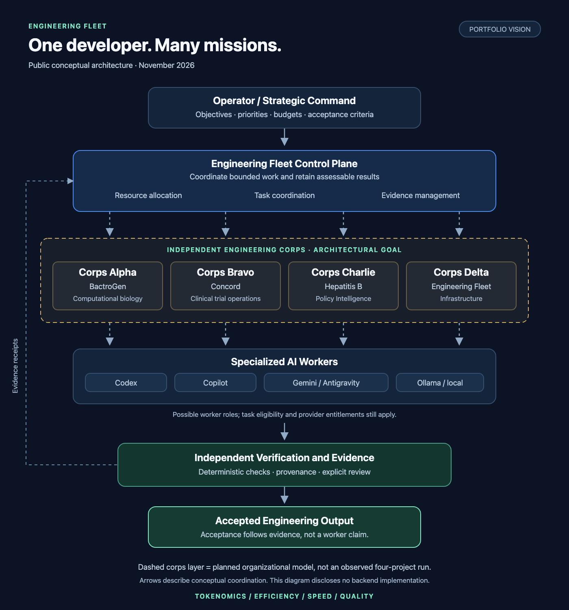

# Architecture: strategic command to accepted output

Engineering Fleet applies the organizational idea of Napoleon's corps system to software work: independent units with enough specialization to advance an objective, coordinated under common strategy. The analogy concerns delegation, coordination, and accountability.

## Strategic command

The operator sets objectives, priorities, budgets, and acceptance criteria. Fleet is the coordinating control plane. The source implements task records, worker assignments, constrained routing, retained artifacts, verification records, and review workflows. These are the foundations for the corps architecture; they do not by themselves demonstrate a portfolio operating concurrently.

## Independent engineering corps — architectural goal

| Conceptual unit | Possible mission | Evidence status |
|---|---|---|
| Corps Alpha | BactroGen and computational biology | Proposed portfolio assignment |
| Corps Bravo | Concord and clinical trial operations | Proposed portfolio assignment |
| Corps Charlie | Hepatitis B Policy Intelligence | Proposed portfolio assignment |
| Corps Delta | Fleet infrastructure | Proposed portfolio assignment |

Each unit would receive a bounded mission, eligible resources, explicit dependencies, and independent acceptance requirements. No four-corps live execution is claimed. Work on a shared repository would also require coordination of changes and verification.

## Engineering infantry

Workers may include multiple Codex instances, GitHub Copilot, Gemini or Antigravity, local Ollama models, and specialized review or verification workers. An adapter being implemented is distinct from an authenticated provider being eligible for a particular task. Capabilities, entitlements, availability, resources, and authorization determine which workers may actually run.

One Codex session is not the conceptual ceiling. Multiple eligible workers could contribute to a shared objective or different projects, provided dependencies and resource constraints permit it. Multi-provider and multi-repository concurrency still require scoped operational demonstrations.

## Verification and evidence

The useful unit of output is an accepted engineering result. A worker submission is a candidate. Deterministic verification and explicit review establish acceptance within their recorded scope. Source identity, retained artifacts, and provenance help distinguish what was attempted, produced, checked, and accepted.

Resource allocation, task coordination, and evidence management span the process. Their public diagram is conceptual; it reveals no scheduling algorithm, provider configuration, security topology, or accounting implementation.

## What is established

At private source `96545043d0e55127c6e0efcfd03ccfbd55b44110`, the latest retained full verification passed lint, typecheck, tests, and build. Historical bounded live coding at an older version reached verified draft delivery. The four-corps arrangement above is a future organizational model, not an implemented production deployment. See [engineering results](engineering-results.md) for exact classifications and scope.

The diagram's editable [SVG](../assets/architecture.svg) is newly authored explanatory material. It contains no extracted backend source.
