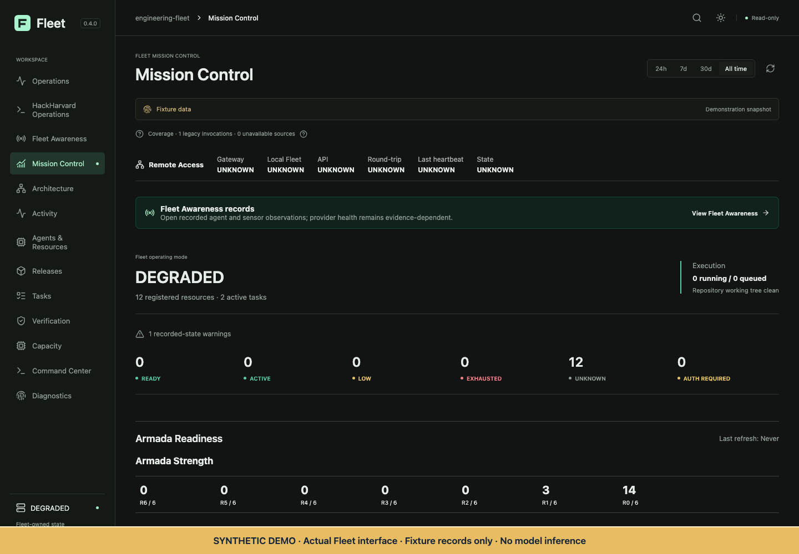

# Mission Control: synthetic interface walkthrough

**Every task, count, capacity value, provider status, and verification result shown in this demonstration is synthetic.** It illustrates the actual interface, not current operations. The gold synthetic-demo label is an added publication annotation. The dashboard itself is the existing compiled application.

## What the demonstration shows

Mission Control exposes recorded operating mode, execution state, resources, approvals, and verification. Its companion Verification page distinguishes recorded checks from live acceptance evidence. Unknown and unavailable states remain visible rather than becoming invented healthy readings.

The [two-view animation](../assets/demo.gif) alternates between Mission Control and Verification. It is an edited walkthrough of two interface captures, not a time-series recording of work completing. A fixture's green proof indicator or passing count is not one of the real engineering results reported elsewhere in this showcase.

## How it was captured

- Frozen compiled build bound to private source `96545043d0e55127c6e0efcfd03ccfbd55b44110`.
- Existing isolated dashboard fixture mode, with an empty demonstration repository and isolated home.
- No real repository state, private tasks, execution logs, provider account, credentials, or balances supplied to the interface.
- Browser requests restricted to reads of the local demonstration origin; outbound destinations and mutation requests were blocked.
- No model inference, provider refresh action, task dispatch, or promotional live execution initiated.
- Visible content and both animation frames reviewed for private paths, personal data, and sensitive configuration.

The capture uses compiled UI assets locally. Only rasterized interface views are published; no proprietary application source, scripts, bundle, or API implementation is included.

## Reading the example

The [synthetic execution JSON](../examples/synthetic-execution.json) is a separately authored fictional narrative: assignment → candidate → independent checks → review. It is not a backend API contract, retained live receipt, or demonstration that a provider ran.

[Real measurements and exact scopes](engineering-results.md) · [Current operational limitations](limitations.md)
